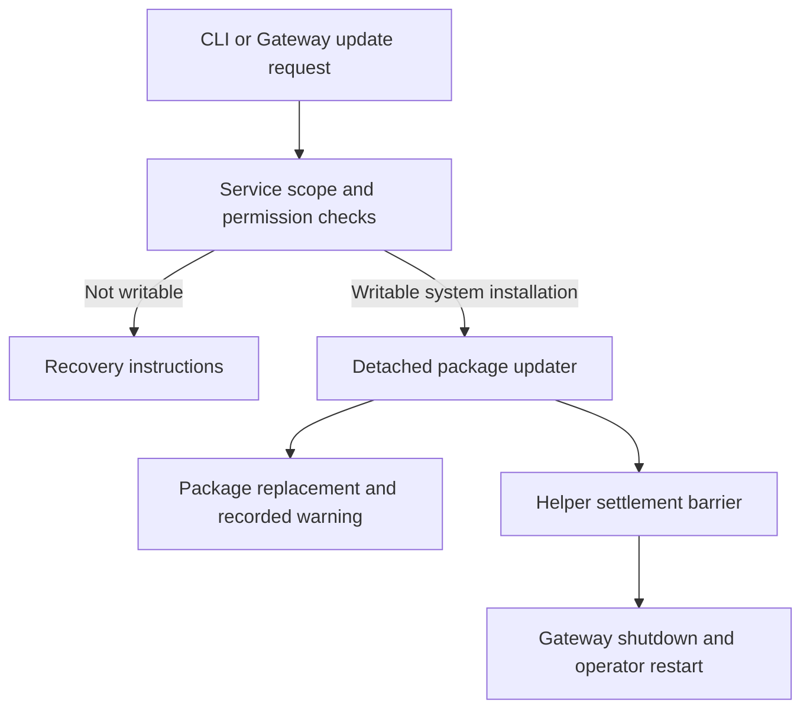

Codex review: needs real behavior proof before merge. _Reviewed September 23, 2026, 11:01 AM ET / 15:01 UTC._

# ClawSweeper review

## What this changes

Allows writable system-service installations to update their packages, preserves operator-controlled restarts, and delays replacement-triggered Gateway shutdown until the updater settles.

## Regression provenance

Possible regression — suspected (reviewed change). No predecessor PR is attributed.

## Merge readiness

⛔ **Blocked before merge - 5 items remain**

The repair remains necessary and has substantial live validation, but the newly admitted system-service path can continue after a profile requester’s access grant is revoked.

**Priority:** P0
**Reviewed head:** `f5aff322ea17cb05b49ced90fe0837ed75b5e4b2`

## Review scores

| Measure | Result | What it means |
|---|---|---|
| **Overall readiness** | 🦐 gold shrimp **(3/6)** | Strong operational proof and a coherent repair are limited by an introduced requester-authorization defect. |
| **Proof confidence** | 🦐 gold shrimp **(3/6)** | Needs stronger real behavior proof before merge: Authority-chain proof required: supplied live CLI/RPC traces substantiate package replacement, permission refusal, warning persistence, and settlement, but do not cover a profile requester whose access-policy grant is revoked during validation. Preserve that positive evidence and add redacted final-effect traces for allowed and revoked grants, showing refusal before package mutation and safe settlement. No stored-data contract changes are introduced. After adding proof, update the PR body; ClawSweeper should re-review automatically. If it does not, the PR author or someone with repository write access can comment `@clawsweeper re-review`. |
| **Patch quality** | 🦐 gold shrimp **(3/6)** | Security review found an item that needs attention. |

## Verification

| Check | Result | Evidence |
|---|---|---|
| **Real behavior** | Needs proof | Needs stronger real behavior proof before merge: Authority-chain proof required: supplied live CLI/RPC traces substantiate package replacement, permission refusal, warning persistence, and settlement, but do not cover a profile requester whose access-policy grant is revoked during validation. Preserve that positive evidence and add redacted final-effect traces for allowed and revoked grants, showing refusal before package mutation and safe settlement. No stored-data contract changes are introduced. After adding proof, update the PR body; ClawSweeper should re-review automatically. If it does not, the PR author or someone with repository write access can comment `@clawsweeper re-review`. |
| **Evidence reviewed** | 9 items | Introduced changes and merge ownership: Reviewed the pinned merge-base-to-head delta. Raw test-merge parents are the pinned base followed by the exact PR head; its handoff changes retain the cancellation guard and forced no-restart path. Current main still refuses system-service updates: The fetched main revision still throws the blanket user-scope requirement before creating the update handoff owner. Published-driver limitation: The v2026.9.5 source contains the same refusal. The PR documents the one-time manual bootstrap rather than claiming candidate code can repair the already-running driver. |
| **Findings** | 1 actionable finding | [P1] Preserve requester revocation before system-service activation |
| **Security** | Needs attention | Revoked profile access can retain package-update authority: The new cancellation guard and no-restart path bypass the original grant revalidation while identity-only continuation checks remain satisfied, allowing a previously authorized requester to reach package mutation after grant revocation. |

## How this fits together

The update handoff connects Gateway update requests to a detached package updater. It controls admission, process lifetime, and reporting while leaving system-service restarts to the operator.

## Before merge

- [ ] **Add real behavior proof** - Needs stronger real behavior proof before merge: Authority-chain proof required: supplied live CLI/RPC traces substantiate package replacement, permission refusal, warning persistence, and settlement, but do not cover a profile requester whose access-policy grant is revoked during validation. Preserve that positive evidence and add redacted final-effect traces for allowed and revoked grants, showing refusal before package mutation and safe settlement. No stored-data contract changes are introduced. After adding proof, update the PR body; ClawSweeper should re-review automatically. If it does not, the PR author or someone with repository write access can comment `@clawsweeper re-review`.
- [ ] **Preserve requester revocation before system-service activation (P1)** - For a profile-authorized chat update, revoke the access-policy plugin grant while the updater is staging or validating. This new guard returns `cancel-unavailable` as soon as the updater starts. The added `--no-restart` path also skips `prepareTransferredGateway`, so the original Gateway-held grant is never checked through `beforePark`. The updater continuation checks native custody and profile identity, but deliberately does not check that plugin grant (`createManagedUpdateRequesterContinuationAuthority` and `captureLinkedOperatorAdminIdentity`). Package replacement can therefore proceed after revocation. Preserve a live authorization check before activation without restoring unsafe SIGKILL of an updater that may already be writing.
- [ ] **Resolve security concern: Revoked profile access can retain package-update authority** - The new cancellation guard and no-restart path bypass the original grant revalidation while identity-only continuation checks remain satisfied, allowing a previously authorized requester to reach package mutation after grant revocation.
- [ ] **Resolve merge risk (P1)** - A profile administrator whose access-policy grant is revoked during system-service update validation can retain the ability to replace the installed package.
- [ ] **Complete next step (P2)** - Repair requester-grant revocation handling and provide final-effect proof that revoked access cannot reach package activation.

## Findings

- [P1] Preserve requester revocation before system-service activation — `src/infra/update-managed-service-handoff.ts:1152-1153`
- [high] Revoked profile access can retain package-update authority — `src/infra/update-managed-service-handoff.ts:1153`

<strong>Agent review details</strong>

### Security

Needs attention: The system-service path can outlive a revoked profile access grant; no unrelated dependency or supply-chain changes were found.

### PR surface

Source +193, Tests +436, Docs +32. Total +661 across 27 files.

View PR surface stats

| Area | Files | Added | Removed | Net |
|---|---:|---:|---:|---:|
| Source | 12 | 248 | 55 | +193 |
| Tests | 14 | 472 | 36 | +436 |
| Docs | 1 | 32 | 0 | +32 |
| Config | 0 | 0 | 0 | 0 |
| Generated | 0 | 0 | 0 | 0 |
| Other | 0 | 0 | 0 | 0 |
| **Total** | **27** | **752** | **91** | **+661** |

### Review metrics

| Metric | Value | Why it matters |
|---|---|---|
| **Production versus test growth** | Production +193 net; tests/support +436 net | The PR explains production growth through shared admission, cgroup lifetime protection, and durable restart guidance. |

### Root-cause cluster

Relationship: `fixed_by_candidate`
Canonical: https://github.com/openclaw/openclaw/issues/156409
Summary: This PR is the explicitly linked implementation candidate for the reported system-service update refusal.

Members:
- `canonical`: https://github.com/openclaw/openclaw/issues/156409 - The report contains the exact refusal removed by the patch and explicit maintainer repair direction.

Proposal only: this assessment does not dispatch repair, suppress jobs, mutate sibling items, close, or merge anything.

### Merge-risk options

**Maintainer options:**
1. **Retain live authorization through activation (recommended)**  
   Separate requester revocation from destructive process cancellation, and reject package activation after the original access grant expires or is revoked.

### Technical review

Best possible solution:

Keep shared package admission and operator-owned restarts, enforce live requester authorization before activation, and retain inline recovery guidance.

Do we have a high-confidence way to reproduce the issue?

Yes, from source: current main rejects system-only systemd handoffs before spawning the updater. The introduced revocation defect is also source-traceable; no runtime reproduction was executed in this read-only review.

Is this the best way to solve the issue?

The shared admission owner is the right repair boundary, but the no-restart path must preserve requester authorization independently of service parking and safe updater settlement.

Full review comments:

- [P1] Preserve requester revocation before system-service activation — `src/infra/update-managed-service-handoff.ts:1152-1153`
  For a profile-authorized chat update, revoke the access-policy plugin grant while the updater is staging or validating. This new guard returns `cancel-unavailable` as soon as the updater starts. The added `--no-restart` path also skips `prepareTransferredGateway`, so the original Gateway-held grant is never checked through `beforePark`. The updater continuation checks native custody and profile identity, but deliberately does not check that plugin grant (`createManagedUpdateRequesterContinuationAuthority` and `captureLinkedOperatorAdminIdentity`). Package replacement can therefore proceed after revocation. Preserve a live authorization check before activation without restoring unsafe SIGKILL of an updater that may already be writing.
  Confidence: 0.93

Overall correctness: patch is incorrect
Overall confidence: 0.93

AGENTS.md: found and applied where relevant.

Codex review notes: model internal, reasoning medium; reviewed against [2a88df00f68d](https://github.com/openclaw/openclaw/commit/2a88df00f68dd42c9f6f8ac0dc9ec565417ba503).

### Labels

Label changes:

- add `P0`: The linked official-release report describes a blocked Update action requiring manual operator recovery, meeting the update UX override.
- add `merge-risk: 🚨 security-boundary`: The newly admitted no-restart path suppresses revocation cancellation without preserving the original access-policy check before package mutation.
- add `rating: 🦐 gold shrimp`: Overall readiness is 🦐 gold shrimp; proof is 🦐 gold shrimp and patch quality is 🦐 gold shrimp.
- add `status: 📣 needs proof`: The PR needs real behavior proof before ClawSweeper can clear the contributor ask. Needs stronger real behavior proof before merge: Authority-chain proof required: supplied live CLI/RPC traces substantiate package replacement, permission refusal, warning persistence, and settlement, but do not cover a profile requester whose access-policy grant is revoked during validation. Preserve that positive evidence and add redacted final-effect traces for allowed and revoked grants, showing refusal before package mutation and safe settlement. No stored-data contract changes are introduced. After adding proof, update the PR body; ClawSweeper should re-review automatically. If it does not, the PR author or someone with repository write access can comment `@clawsweeper re-review`.

Label justifications:

- `P0`: The linked official-release report describes a blocked Update action requiring manual operator recovery, meeting the update UX override.
- `merge-risk: 🚨 security-boundary`: The newly admitted no-restart path suppresses revocation cancellation without preserving the original access-policy check before package mutation.
- `rating: 🦐 gold shrimp`: Overall readiness is 🦐 gold shrimp; proof is 🦐 gold shrimp and patch quality is 🦐 gold shrimp.
- `status: 📣 needs proof`: The PR needs real behavior proof before ClawSweeper can clear the contributor ask. Needs stronger real behavior proof before merge: Authority-chain proof required: supplied live CLI/RPC traces substantiate package replacement, permission refusal, warning persistence, and settlement, but do not cover a profile requester whose access-policy grant is revoked during validation. Preserve that positive evidence and add redacted final-effect traces for allowed and revoked grants, showing refusal before package mutation and safe settlement. No stored-data contract changes are introduced. After adding proof, update the PR body; ClawSweeper should re-review automatically. If it does not, the PR author or someone with repository write access can comment `@clawsweeper re-review`.

### Evidence

Security concerns:

- [high] Revoked profile access can retain package-update authority — `src/infra/update-managed-service-handoff.ts:1153`
  The new cancellation guard and no-restart path bypass the original grant revalidation while identity-only continuation checks remain satisfied, allowing a previously authorized requester to reach package mutation after grant revocation.
  Confidence: 0.93

What I checked:

- **Introduced changes and merge ownership:** Reviewed the pinned merge-base-to-head delta. Raw test-merge parents are the pinned base followed by the exact PR head; its handoff changes retain the cancellation guard and forced no-restart path. ([`src/infra/update-managed-service-handoff.ts:1152`](https://github.com/openclaw/openclaw/blob/c7081908856dc619c23adfa87fb0164fb7ca3754/src/infra/update-managed-service-handoff.ts#L1152), [c7081908856d](https://github.com/openclaw/openclaw/commit/c7081908856dc619c23adfa87fb0164fb7ca3754))
- **Current main still refuses system-service updates:** The fetched main revision still throws the blanket user-scope requirement before creating the update handoff owner. ([`src/infra/update-managed-service-handoff.ts:1872`](https://github.com/openclaw/openclaw/blob/2a88df00f68dd42c9f6f8ac0dc9ec565417ba503/src/infra/update-managed-service-handoff.ts#L1872), [2a88df00f68d](https://github.com/openclaw/openclaw/commit/2a88df00f68dd42c9f6f8ac0dc9ec565417ba503))
- **Published-driver limitation:** The v2026.9.5 source contains the same refusal. The PR documents the one-time manual bootstrap rather than claiming candidate code can repair the already-running driver. ([`src/infra/update-managed-service-handoff.ts:2553`](https://github.com/openclaw/openclaw/blob/ec9c1a13db8938e5a3eaa51fca2e981cde2395a9/src/infra/update-managed-service-handoff.ts#L2553), [ec9c1a13db89](https://github.com/openclaw/openclaw/commit/ec9c1a13db8938e5a3eaa51fca2e981cde2395a9))
- **Explicit repair direction:** In https://github.com/openclaw/openclaw/issues/156409, steipete explicitly requests writable package updates with operator-owned restarts and exact recovery commands; the follow-up acknowledges the published-version manual bootstrap limitation.
- **Revocation cancellation is suppressed:** System-service helpers now reject cancellation once updaterStarted is true. That flag is set when the updater admission pipe opens, before candidate validation finishes; system-service commands also receive --no-restart, bypassing the parking callback that rechecks the original Gateway-held grant. ([`src/infra/update-managed-service-handoff.ts:1153`](https://github.com/openclaw/openclaw/blob/f5aff322ea17cb05b49ced90fe0837ed75b5e4b2/src/infra/update-managed-service-handoff.ts#L1153), [f5aff322ea17](https://github.com/openclaw/openclaw/commit/f5aff322ea17cb05b49ced90fe0837ed75b5e4b2))
- **Continuation checks do not replace the live access grant:** The updater continuation checks native ownership and profile identity. captureLinkedOperatorAdminIdentity checks identity, role, and policy-plugin selection, whereas the full authority additionally calls hasCurrentGatewayOperatorAccess; revoking only that plugin grant therefore need not invalidate the continuation. ([`src/gateway/channel-operator-authority.ts:94`](https://github.com/openclaw/openclaw/blob/f5aff322ea17cb05b49ced90fe0837ed75b5e4b2/src/gateway/channel-operator-authority.ts#L94), [f5aff322ea17](https://github.com/openclaw/openclaw/commit/f5aff322ea17cb05b49ced90fe0837ed75b5e4b2))

Likely related people:

- **steipete:** Suggested for follow-up; no historical authorship or introduction is verified. (role: unverified routing candidate; confidence: low)
- **Dallin Romney:** Suggested for follow-up; no historical authorship or introduction is verified. (role: unverified routing candidate; confidence: low)

### Rank-up moves

Optional improvements that raise the rating; they are not merge blockers.

- Preserve original access-grant validation before system-service package activation without force-killing write-capable work.
- Add redacted production-boundary evidence showing allowed updates succeed and grant revocation during validation prevents package mutation; updating the PR body should trigger review automatically, with a maintainer @clawsweeper re-review as fallback.

### Rating scale

| Score | Internal tier | Crab rank | Meaning |
|---:|:---:|---|---|
| **6/6** | S | 🦀 challenger crab | Exceptional readiness |
| **5/6** | A | 🦞 diamond lobster | Very strong readiness |
| **4/6** | B | 🐚 platinum hermit | Good normal PR; ordinary maintainer review |
| **3/6** | C | 🦐 gold shrimp | Useful, but confidence is limited |
| **2/6** | D | 🦪 silver shellfish | Proof or implementation needs work |
| **1/6** | F | 🧂 unranked krab | Not merge-ready |
| N/A | NA | 🌊 off-meta tidepool | Rating does not apply |

Overall follows the weaker of proof and patch quality.
Shiny media proof means a screenshot, video, or linked artifact directly shows the changed behavior. Runtime, network, CSP, and security claims still need visible diagnostics.

### Workflow

- ClawSweeper keeps one durable marker-backed review comment per issue or PR.
- Re-runs edit this comment so the latest verdict, findings, and automation markers stay together instead of adding duplicate bot comments.
- A fresh review can be triggered by eligible `@clawsweeper re-review` comments, exact-item GitHub events, scheduled/background review runs, or manual workflow dispatch.
- PR/issue authors and users with repository write access can comment `@clawsweeper re-review` or `@clawsweeper re-run` on an open PR or issue to request a fresh review only.
- Maintainers can also comment `@clawsweeper review` to request a fresh review only.
- Fresh-review commands do not start repair, autofix, rebase, CI repair, or automerge.
- Maintainer-only repair and merge flows require explicit commands such as `@clawsweeper autofix`, `@clawsweeper automerge`, `@clawsweeper fix ci`, or `@clawsweeper address review`.
- Maintainers can comment `@clawsweeper explain` to ask for more context, or `@clawsweeper stop` to stop active automation.

<!-- clawsweeper-security:security-sensitive item=156584 sha=f5aff322ea17cb05b49ced90fe0837ed75b5e4b2 confidence=high updated_at=2026-09-23T14:57:19Z reviewed_at=2026-09-23T15:01:22.657Z lease_owner=github-run-35877367338-1 lease_comment_id=5797167774 source_revision=8ca78a62725bbbd7088a5af52609f5d3ab4fa0b174a21b7a3ecd8f35a6b8cf9b live_verification=absent -->
<!-- clawsweeper-verdict:needs-human item=156584 sha=f5aff322ea17cb05b49ced90fe0837ed75b5e4b2 confidence=high updated_at=2026-09-23T14:57:19Z reviewed_at=2026-09-23T15:01:22.657Z lease_owner=github-run-35877367338-1 lease_comment_id=5797167774 source_revision=8ca78a62725bbbd7088a5af52609f5d3ab4fa0b174a21b7a3ecd8f35a6b8cf9b live_verification=absent -->
<!-- clawsweeper-review-state:blocked item=156584 sha=f5aff322ea17cb05b49ced90fe0837ed75b5e4b2 v=1 -->

<!-- clawsweeper-review-version item=156584 reviewed_at=2026-09-23T15:01:22.657Z sha=f5aff322ea17cb05b49ced90fe0837ed75b5e4b2 source_revision=8ca78a62725bbbd7088a5af52609f5d3ab4fa0b174a21b7a3ecd8f35a6b8cf9b lease_owner=github-run-35877367338-1 lease_comment_id=5797167774 v=1 -->

<!-- clawsweeper-review item=156584 -->