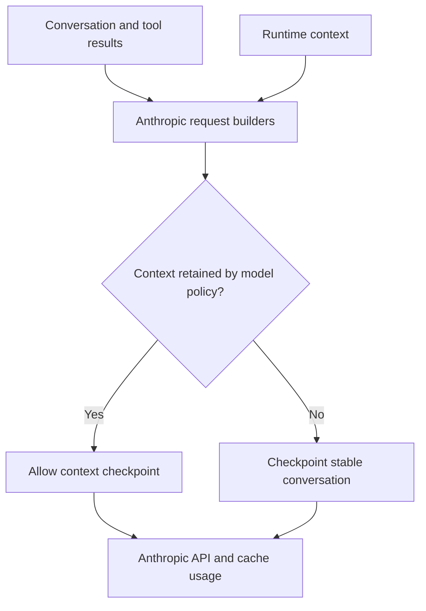

Codex review: needs maintainer review before merge. _Reviewed September 9, 2026, 12:56 PM ET / 16:56 UTC (Revision 7)._

# ClawSweeper review

## What this changes

The PR preserves Anthropic conversation-cache reuse around temporary runtime context, omits empty beta headers, and adds packaged regression coverage to release verification.

## Merge readiness

✅ **Ready for maintainer review**

This remains a useful repair: current main still permits transient context to receive cache checkpoints, and no merged replacement resolves it. The revised patch addresses the earlier lifecycle concern, has convincing live API evidence, and introduces no identified blocking defect.

**Priority:** P2
**Reviewed head:** `18434a73af52a34720ea51d008ef19c2be61976b`

## Review scores

| Measure | Result | What it means |
|---|---|---|
| **Overall readiness** | 🐚 platinum hermit **(4/6)** | A focused runtime repair with strong live cache evidence and useful regression coverage; no blocking correctness finding remains. |
| **Proof confidence** | 🦞 diamond lobster **(5/6)** | Sufficient (live_output): The captured live results exercise both installed Anthropic builders against the real API through initial history, two tool continuations, and a subsequent user turn, showing growing cache reads and small new writes. The inspected harness checks the changed checkpoint boundary; Gateway scheduling is explicitly outside this proof. |
| **Patch quality** | 🐚 platinum hermit **(4/6)** | No actionable review findings were identified. |

## Verification

| Check | Result | Evidence |
|---|---|---|
| **Real behavior** | Verified | Sufficient (live_output): The captured live results exercise both installed Anthropic builders against the real API through initial history, two tool continuations, and a subsequent user turn, showing growing cache reads and small new writes. The inspected harness checks the changed checkpoint boundary; Gateway scheduling is explicitly outside this proof. |
| **Evidence reviewed** | 9 items | Pinned PR remains open: The REST API confirmed the PR is open and unmerged, with head 18434a73af52a34720ea51d008ef19c2be61976b and base a57c799c86dfa3b08e1994b75700bda6ffced01f. The supplied introduction delta matches those revisions; the stale test merge was not used to infer removals. Current main still needs the repair: Current-main conversion does not collect transient-carrier exclusions, and the provider calls cache allocation without an exclusion set. The allocator consequently remains able to select the trailing carrier. Lifecycle-aware exclusion: The shared converter uses the existing model contract and records emitted indexes only for nonempty transient carriers. Both request builders pass those indexes to the existing allocator, preserving grouped tool-result indexing and retained-context eligibility. |
| **Findings** | None | None. |
| **Security** | None | None. |

## How this fits together

OpenClaw’s Anthropic request builders turn conversation history, tool results, and runtime context into provider requests. Cache checkpoints determine which stable portions Anthropic can reuse on subsequent requests.

## Before merge

None.

<strong>Agent review details</strong>

### Security

None.

### PR surface

Source +24, Tests +225, Docs +11, Config +7, Other +397. Total +664 across 19 files.

View PR surface stats

| Area | Files | Added | Removed | Net |
|---|---:|---:|---:|---:|
| Source | 3 | 29 | 5 | +24 |
| Tests | 6 | 309 | 84 | +225 |
| Docs | 1 | 11 | 0 | +11 |
| Config | 2 | 7 | 0 | +7 |
| Generated | 0 | 0 | 0 | 0 |
| Other | 7 | 399 | 2 | +397 |
| **Total** | **19** | **755** | **91** | **+664** |

### Review metrics

| Metric | Value | Why it matters |
|---|---|---|
| **Runtime versus proof growth** | Runtime net +24 lines; regression tests net +201; Docker proof harness +385 | Most growth establishes regression evidence while the runtime repair reuses existing conversion and cache-policy owners. |
| **Release proof budget** | 1 added lane; 8 requests; 0 retries; 15-minute lane deadline | Stable/full release verification gains a bounded live cache check using the existing Docker scheduler. |

### Root-cause cluster

Relationship: `fixed_by_candidate`
Canonical: https://github.com/openclaw/openclaw/issues/140607
Summary: This PR is the active implementation candidate for the linked transient-carrier cache defect; related coverage and capture work do not replace it.

Members:
- `canonical`: https://github.com/openclaw/openclaw/issues/140607 - The linked issue defines the cache-breakpoint defect this PR addresses.
- `partial_overlap`: https://github.com/openclaw/openclaw/pull/141585 - The broader alternative addressed the same cache symptom but was closed unmerged.
- `adjacent_distinct`: https://github.com/openclaw/openclaw/pull/143010 - Adds Gateway cache coverage and explicitly leaves the production repair separate.
- `adjacent_distinct`: https://github.com/openclaw/openclaw/pull/143012 - Integrates the separate Gateway coverage stack.
- `adjacent_distinct`: https://github.com/openclaw/openclaw/pull/143107 - Merged capture-diagnostics repair explicitly does not fix cache eligibility.

Proposal only: this assessment does not dispatch repair, suppress jobs, mutate sibling items, close, or merge anything.

### Technical review

Best possible solution:

Keep cache eligibility tied to the existing context-retention contract in shared conversion, with packaged live regression coverage protecting reuse.

Do we have a high-confidence way to reproduce the issue?

Yes, from source: with transient context and available cache-marker capacity, current main can checkpoint the carrier after it moves behind tool results. This review did not execute a failing current-main run.

Is this the best way to solve the issue?

Yes. Reusing the existing model lifecycle predicate and cache allocator repairs both builders without changing context roles, persisted history, or user cache settings.

AGENTS.md: found and applied where relevant.

Codex review notes: model internal, reasoning medium; reviewed against [577492132500](https://github.com/openclaw/openclaw/commit/577492132500d5c5f66022c25023643e0554422b).

### Labels

Label justifications:

- `P2`: This repairs a model-specific prompt-cache efficiency defect without evidence of a core outage or lost messages.
- `rating: 🐚 platinum hermit`: Overall readiness is 🐚 platinum hermit; proof is 🦞 diamond lobster and patch quality is 🐚 platinum hermit.
- `status: 👀 ready for maintainer look`: ClawSweeper has no concrete contributor-facing blocker left for this PR. Sufficient (live_output): The captured live results exercise both installed Anthropic builders against the real API through initial history, two tool continuations, and a subsequent user turn, showing growing cache reads and small new writes. The inspected harness checks the changed checkpoint boundary; Gateway scheduling is explicitly outside this proof.
- `proof: sufficient`: Contributor real behavior proof is sufficient. The captured live results exercise both installed Anthropic builders against the real API through initial history, two tool continuations, and a subsequent user turn, showing growing cache reads and small new writes. The inspected harness checks the changed checkpoint boundary; Gateway scheduling is explicitly outside this proof.

### Evidence

What I checked:

- **Pinned PR remains open:** The REST API confirmed the PR is open and unmerged, with head 18434a73af52a34720ea51d008ef19c2be61976b and base a57c799c86dfa3b08e1994b75700bda6ffced01f. The supplied introduction delta matches those revisions; the stale test merge was not used to infer removals. ([18434a73af52](https://github.com/openclaw/openclaw/commit/18434a73af52a34720ea51d008ef19c2be61976b))
- **Current main still needs the repair:** Current-main conversion does not collect transient-carrier exclusions, and the provider calls cache allocation without an exclusion set. The allocator consequently remains able to select the trailing carrier. ([`packages/ai/src/providers/anthropic.ts:665`](https://github.com/openclaw/openclaw/blob/577492132500d5c5f66022c25023643e0554422b/packages/ai/src/providers/anthropic.ts#L665), [577492132500](https://github.com/openclaw/openclaw/commit/577492132500d5c5f66022c25023643e0554422b))
- **Lifecycle-aware exclusion:** The shared converter uses the existing model contract and records emitted indexes only for nonempty transient carriers. Both request builders pass those indexes to the existing allocator, preserving grouped tool-result indexing and retained-context eligibility. ([`packages/ai/src/transports/anthropic-messages.ts:146`](https://github.com/openclaw/openclaw/blob/18434a73af52a34720ea51d008ef19c2be61976b/packages/ai/src/transports/anthropic-messages.ts#L146), [18434a73af52](https://github.com/openclaw/openclaw/commit/18434a73af52a34720ea51d008ef19c2be61976b))
- **Existing lifecycle contract and discussion:** The provider documentation distinguishes retained prefix-binding context from transient context. The linked issue’s human comment correctly identifies appendOnlyRuntimeContext as the deciding branch; the revised patch respects that distinction rather than excluding every carrier. Public docs: [`docs/providers/anthropic.md`](https://docs.openclaw.ai/providers/anthropic). ([`docs/providers/anthropic.md:263`](https://docs.openclaw.ai/providers/anthropic), [18434a73af52](https://github.com/openclaw/openclaw/commit/18434a73af52a34720ea51d008ef19c2be61976b))
- **After-fix live API proof:** The captured PR body, sourceRevision af68b76b95d69f7c01f8b92259386846076b58147edc8b6e1a46077e411ead04, reports eight installed-package requests against claude-sonnet-4-6. Provider cache reads progress 8042→8572→9075 after the initial write; managed-transport reads progress 8041→8570→9073. Final writes are 18 tokens for both. The inspected harness observes production payloads without rewriting them, moves transient context across two returned tool calls and a new user turn, and checks prefix identity and cache usage. The body explicitly limits this to builder/API proof and reports unchanged live-validated implementation and harness blobs. ([`scripts/e2e/anthropic-cache-live.mts:113`](https://github.com/openclaw/openclaw/blob/18434a73af52a34720ea51d008ef19c2be61976b/scripts/e2e/anthropic-cache-live.mts#L113), [18434a73af52](https://github.com/openclaw/openclaw/commit/18434a73af52a34720ea51d008ef19c2be61976b))
- **Release verification and security boundaries:** The new lane uses the existing functional package image, limits execution to eight requests with deadlines and no retries, and requires an API key in both workflow preflights. Tests execute the workflow selection and credential checks. No Action reference, dependency source, permission grant, or persistent schema changes are introduced. ([`scripts/lib/docker-e2e-scenarios.mts:419`](https://github.com/openclaw/openclaw/blob/18434a73af52a34720ea51d008ef19c2be61976b/scripts/lib/docker-e2e-scenarios.mts#L419), [18434a73af52](https://github.com/openclaw/openclaw/commit/18434a73af52a34720ea51d008ef19c2be61976b))

Likely related people:

- **steipete:** Suggested for follow-up; no historical authorship or introduction is verified. (role: unverified routing candidate; confidence: low)

### Rating scale

| Score | Internal tier | Crab rank | Meaning |
|---:|:---:|---|---|
| **6/6** | S | 🦀 challenger crab | Exceptional readiness |
| **5/6** | A | 🦞 diamond lobster | Very strong readiness |
| **4/6** | B | 🐚 platinum hermit | Good normal PR; ordinary maintainer review |
| **3/6** | C | 🦐 gold shrimp | Useful, but confidence is limited |
| **2/6** | D | 🦪 silver shellfish | Proof or implementation needs work |
| **1/6** | F | 🧂 unranked krab | Not merge-ready |
| N/A | NA | 🌊 off-meta tidepool | Rating does not apply |

Overall follows the weaker of proof and patch quality.
Shiny media proof means a screenshot, video, or linked artifact directly shows the changed behavior. Runtime, network, CSP, and security claims still need visible diagnostics.

### Workflow

- ClawSweeper keeps one durable marker-backed review comment per issue or PR.
- Re-runs edit this comment so the latest verdict, findings, and automation markers stay together instead of adding duplicate bot comments.
- A fresh review can be triggered by eligible `@clawsweeper re-review` comments, exact-item GitHub events, scheduled/background review runs, or manual workflow dispatch.
- PR/issue authors and users with repository write access can comment `@clawsweeper re-review` or `@clawsweeper re-run` on an open PR or issue to request a fresh review only.
- Maintainers can also comment `@clawsweeper review` to request a fresh review only.
- Fresh-review commands do not start repair, autofix, rebase, CI repair, or automerge.
- Maintainer-only repair and merge flows require explicit commands such as `@clawsweeper autofix`, `@clawsweeper automerge`, `@clawsweeper fix ci`, or `@clawsweeper address review`.
- Maintainers can comment `@clawsweeper explain` to ask for more context, or `@clawsweeper stop` to stop active automation.

### History

Review history (6 earlier review cycles)

<!-- clawsweeper-review-history v=1 total=6 -->
- reviewed 2026-09-07T02:06:00.381Z sha b0d839ea678e49f2af861160ae17c8cda7fdcdc7 :: needs real behavior proof before merge. :: none
- reviewed 2026-09-07T02:14:34.162Z sha 7bea5a8a093667b31d7073ff71f48cfba19d2218 :: needs real behavior proof before merge. :: none
- reviewed 2026-09-07T02:23:18.807Z sha 7bea5a8a093667b31d7073ff71f48cfba19d2218 :: needs real behavior proof before merge. :: none
- reviewed 2026-09-07T02:40:11.151Z sha 4e30fc456d01d7f38ad4c73460dcca96699a6e83 :: needs real behavior proof before merge. :: [P2] Distinguish prior turns from actual carrier relocation
- reviewed 2026-09-07T03:29:04.046Z sha 3b3c5b4e8cd660712f536e70d533ec2d36a65221 :: needs maintainer review before merge. :: none
- reviewed 2026-09-07T03:35:07.808Z sha 3b3c5b4e8cd660712f536e70d533ec2d36a65221 :: needs maintainer review before merge. :: none

<!-- clawsweeper-verdict:needs-human item=140621 sha=18434a73af52a34720ea51d008ef19c2be61976b confidence=high updated_at=2026-09-09T16:54:03Z reviewed_at=2026-09-09T16:56:50.385Z lease_owner=github-run-34379349448-1 lease_comment_id=5605567221 source_revision=af68b76b95d69f7c01f8b92259386846076b58147edc8b6e1a46077e411ead04 live_verification=absent -->
<!-- clawsweeper-review-state:ready item=140621 sha=18434a73af52a34720ea51d008ef19c2be61976b v=1 -->

<!-- clawsweeper-review-version item=140621 reviewed_at=2026-09-09T16:56:50.385Z sha=18434a73af52a34720ea51d008ef19c2be61976b source_revision=af68b76b95d69f7c01f8b92259386846076b58147edc8b6e1a46077e411ead04 lease_owner=github-run-34379349448-1 lease_comment_id=5605567221 v=1 -->

<!-- clawsweeper-review item=140621 -->