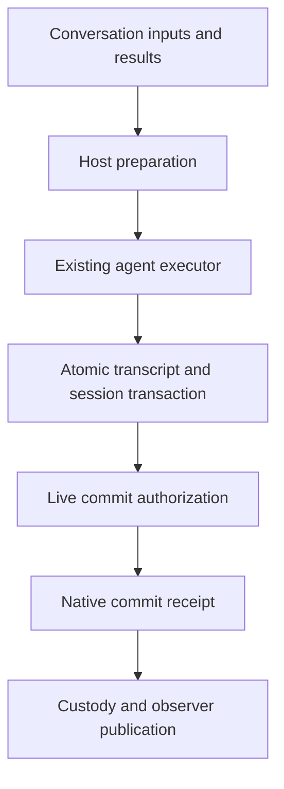

Codex review: needs maintainer review before merge. _Reviewed October 3, 2026, 1:01 AM ET / 05:01 UTC (Revision 8)._

# ClawSweeper review

## What this changes

Moves atomic conversation-message appends, pending-input consumption, session updates, and Goal receipts into the existing agent database worker while preserving released callback behavior.

## Merge readiness

✅ **Ready for maintainer review**

The worker cutover remains useful and is not implemented on current main. No actionable correctness or security finding remains in the pinned diff; the recorded boundary proof supports the change.

**Priority:** P2
**Reviewed head:** `83821f0fe1ad3a434f077ac867b0fc2159ab69df`

## Review scores

| Measure | Result | What it means |
|---|---|---|
| **Overall readiness** | 🐚 platinum hermit **(4/6)** | A coherent worker cutover with strong fault-boundary evidence and no remaining actionable finding. |
| **Proof confidence** | 🦞 diamond lobster **(5/6)** | Sufficient (terminal): Recorded after-fix runs exercise the production compound-turn coordinator through the real worker transport and SQLite owner, including final-COMMIT revocation with no durable message effect, rollback, lost replies, custody publication, and FIFO settlement. Inspected harness source supports those claims; existing stored contracts are unchanged. |
| **Patch quality** | 🐚 platinum hermit **(4/6)** | No actionable review findings were identified. |

## Verification

| Check | Result | Evidence |
|---|---|---|
| **Real behavior** | Verified | Sufficient (terminal): Recorded after-fix runs exercise the production compound-turn coordinator through the real worker transport and SQLite owner, including final-COMMIT revocation with no durable message effect, rollback, lost replies, custody publication, and FIFO settlement. Inspected harness source supports those claims; existing stored contracts are unchanged. |
| **Evidence reviewed** | 9 items | Pinned introduction and continued necessity: Reviewed the introduced delta from 9e34368e594b358692f552624d4879f316ab3ddc to 83821f0fe1ad3a434f077ac867b0fc2159ab69df. Fetched main still performs compound turns through its native transaction implementation and has no session-turn.ts worker coordinator. The host's stale test merge was not used to infer merge-result regressions. Atomic worker ownership: The shared kernel rereads session identity, evaluates predicates, appends messages, updates the entry, and writes Goal receipts together. The worker uses the existing candidate transfer and native COMMIT receipt rather than introducing another persistence owner. Final-effect authority checks: The existing admission owner authorizes the binding and invokes assertHeld before every transaction or COMMIT grant. The compound coordinator supplies current execution, caller, Goal, writer, and fresh-input guards; pending-input custody receives its additional host check. |
| **Findings** | None | None. |
| **Security** | None | None. |

## How this fits together

Session persistence turns admitted conversation inputs and agent results into durable transcript and session state. The Gateway retains live authority checks and publishes acknowledged results to observers after the worker commits.

## Before merge

None.

<strong>Agent review details</strong>

### Security

None.

### PR surface

Source +1298, Tests +963, Docs +14, Other +2. Total +2277 across 60 files.

View PR surface stats

| Area | Files | Added | Removed | Net |
|---|---:|---:|---:|---:|
| Source | 40 | 1886 | 588 | +1298 |
| Tests | 17 | 1121 | 158 | +963 |
| Docs | 1 | 14 | 0 | +14 |
| Config | 0 | 0 | 0 | 0 |
| Generated | 0 | 0 | 0 | 0 |
| Other | 2 | 3 | 1 | +2 |
| **Total** | **60** | **3024** | **747** | **+2277** |

### Review metrics

| Metric | Value | Why it matters |
|---|---|---|
| **Production and test growth** | production net +1,298; tests net +963 | Production growth is justified by typed compound kernels and their transport coordination while reusing the existing executor and publication owners. |

### Technical review

Best possible solution:

Keep compound persistence atomic in the existing executor, with live host grants, acknowledged publication, and the released native callback compatibility path.

Do we have a high-confidence way to reproduce the issue?

Not applicable as a refactor; current-main source confirms the native compound transaction, and the recorded worker-boundary controls measure the intended cutover.

Is this the best way to solve the issue?

Yes. Reusing the existing executor, atomic kernel, commit receipt, and publication owner is a coherent path, with released opaque callbacks retaining their established transaction visibility.

AGENTS.md: found and applied where relevant.

Codex review notes: model internal, reasoning medium; reviewed against [7ff3b3be3713](https://github.com/openclaw/openclaw/commit/7ff3b3be3713751de356800167d67ce752ad0d04).

### Labels

Label changes:

No label changes.

Label justifications:

- `P2`: This is a useful, bounded session-persistence ownership improvement without evidence of an urgent user-facing regression.
- `rating: 🐚 platinum hermit`: Overall readiness is 🐚 platinum hermit; proof is 🦞 diamond lobster and patch quality is 🐚 platinum hermit.
- `status: 👀 ready for maintainer look`: ClawSweeper has no concrete contributor-facing blocker left for this PR. Sufficient (terminal): Recorded after-fix runs exercise the production compound-turn coordinator through the real worker transport and SQLite owner, including final-COMMIT revocation with no durable message effect, rollback, lost replies, custody publication, and FIFO settlement. Inspected harness source supports those claims; existing stored contracts are unchanged.
- `proof: sufficient`: Contributor real behavior proof is sufficient. Recorded after-fix runs exercise the production compound-turn coordinator through the real worker transport and SQLite owner, including final-COMMIT revocation with no durable message effect, rollback, lost replies, custody publication, and FIFO settlement. Inspected harness source supports those claims; existing stored contracts are unchanged.

### Evidence

What I checked:

- **Pinned introduction and continued necessity:** Reviewed the introduced delta from 9e34368e594b358692f552624d4879f316ab3ddc to 83821f0fe1ad3a434f077ac867b0fc2159ab69df. Fetched main still performs compound turns through its native transaction implementation and has no session-turn.ts worker coordinator. The host's stale test merge was not used to infer merge-result regressions. ([`src/config/sessions/session-accessor.sqlite-transcript-turn.ts:67`](https://github.com/openclaw/openclaw/blob/7ff3b3be3713751de356800167d67ce752ad0d04/src/config/sessions/session-accessor.sqlite-transcript-turn.ts#L67), [7ff3b3be3713](https://github.com/openclaw/openclaw/commit/7ff3b3be3713751de356800167d67ce752ad0d04))
- **Atomic worker ownership:** The shared kernel rereads session identity, evaluates predicates, appends messages, updates the entry, and writes Goal receipts together. The worker uses the existing candidate transfer and native COMMIT receipt rather than introducing another persistence owner. ([`src/config/sessions/session-turn.kernel.ts:99`](https://github.com/openclaw/openclaw/blob/83821f0fe1ad3a434f077ac867b0fc2159ab69df/src/config/sessions/session-turn.kernel.ts#L99), [83821f0fe1ad](https://github.com/openclaw/openclaw/commit/83821f0fe1ad3a434f077ac867b0fc2159ab69df))
- **Final-effect authority checks:** The existing admission owner authorizes the binding and invokes assertHeld before every transaction or COMMIT grant. The compound coordinator supplies current execution, caller, Goal, writer, and fresh-input guards; pending-input custody receives its additional host check. ([`src/config/sessions/session-accessor.sqlite-replacement-worker.ts:129`](https://github.com/openclaw/openclaw/blob/83821f0fe1ad3a434f077ac867b0fc2159ab69df/src/config/sessions/session-accessor.sqlite-replacement-worker.ts#L129), [83821f0fe1ad](https://github.com/openclaw/openclaw/commit/83821f0fe1ad3a434f077ac867b0fc2159ab69df))
- **Production-boundary fault proof:** Inspected the real executor/SQLite harness: revocation at the final COMMIT grant leaves no transcript messages or consumed custody; lost ordinary replies recover the acknowledged commit once; concurrent completion retains physical FIFO. The captured body reports current-head compound/Goal validation passing 30 cases and retains negative controls for unchanged boundary inputs. These executions were contributor-provided evidence, not runs performed by this review. ([`src/config/sessions/session-compound-worker.test.ts:223`](https://github.com/openclaw/openclaw/blob/83821f0fe1ad3a434f077ac867b0fc2159ab69df/src/config/sessions/session-compound-worker.test.ts#L223), [83821f0fe1ad](https://github.com/openclaw/openclaw/commit/83821f0fe1ad3a434f077ac867b0fc2159ab69df))
- **Complete captured discussion evidence:** Recovered and inspected the complete 21,903-unit PR body through the read-only GitHub API. Its SHA-256 exactly matched captured sourceBodySha256 5584799822b09515eec4b18eea10ba522cb5d072ddbdfc54a1507ffd658eb813, resolving the prompt's omitted ranges. Human comments request re-review; the structured previous review reports no remaining findings at this same head. ([83821f0fe1ad](https://github.com/openclaw/openclaw/commit/83821f0fe1ad3a434f077ac867b0fc2159ab69df))
- **Released callback compatibility:** Read v2026.9.8 source through GitHub: the public transcript options already expose prepareMessageAfterIdempotencyCheck and beforeFreshMessageCommit. The strict SDK append still forwards its opaque preparer through the original field; the proposed dispatcher preserves native execution whenever those released callback fields are present. No SDK entrypoint, schema, stored format, or migration is introduced. ([`src/plugin-sdk/session-transcript-runtime.ts:488`](https://github.com/openclaw/openclaw/blob/fc23bc864e4553c2d215e479eeec47b67a0bf943/src/plugin-sdk/session-transcript-runtime.ts#L488), [fc23bc864e45](https://github.com/openclaw/openclaw/commit/fc23bc864e4553c2d215e479eeec47b67a0bf943))

Likely related people:

- **steipete:** Suggested for follow-up; no historical authorship or introduction is verified. (role: unverified routing candidate; confidence: low)

### Rating scale

| Score | Internal tier | Crab rank | Meaning |
|---:|:---:|---|---|
| **6/6** | S | 🦀 challenger crab | Exceptional readiness |
| **5/6** | A | 🦞 diamond lobster | Very strong readiness |
| **4/6** | B | 🐚 platinum hermit | Good normal PR; ordinary maintainer review |
| **3/6** | C | 🦐 gold shrimp | Useful, but confidence is limited |
| **2/6** | D | 🦪 silver shellfish | Proof or implementation needs work |
| **1/6** | F | 🧂 unranked krab | Not merge-ready |
| N/A | NA | 🌊 off-meta tidepool | Rating does not apply |

Overall follows the weaker of proof and patch quality.
Shiny media proof means a screenshot, video, or linked artifact directly shows the changed behavior. Runtime, network, CSP, and security claims still need visible diagnostics.

### Workflow

- ClawSweeper keeps one durable marker-backed review comment per issue or PR.
- Re-runs edit this comment so the latest verdict, findings, and automation markers stay together instead of adding duplicate bot comments.
- A fresh review can be triggered by eligible `@clawsweeper re-review` comments, exact-item GitHub events, scheduled/background review runs, or manual workflow dispatch.
- PR/issue authors and users with repository write access can comment `@clawsweeper re-review` or `@clawsweeper re-run` on an open PR or issue to request a fresh review only.
- Maintainers can also comment `@clawsweeper review` to request a fresh review only.
- Fresh-review commands do not start repair, autofix, rebase, CI repair, or automerge.
- Maintainer-only repair and merge flows require explicit commands such as `@clawsweeper autofix`, `@clawsweeper automerge`, `@clawsweeper fix ci`, or `@clawsweeper address review`.
- Maintainers can comment `@clawsweeper explain` to ask for more context, or `@clawsweeper stop` to stop active automation.

### History

Review history (7 earlier review cycles)

<!-- clawsweeper-review-history v=1 total=7 -->
- reviewed 2026-10-03T00:24:19.446Z sha 4e7ae88cd0ca103b326a1c868d2380e1ac31ef02 :: blocked before merge. :: [P2] Preserve the caller's storage locator in append callbacks | [P2] Move the abort-append fault to the worker boundary
- reviewed 2026-10-03T03:07:20.804Z sha f0c139d3cc9230c9ea4385f090f348cdd55673bd :: needs maintainer review before merge. :: none
- reviewed 2026-10-03T03:27:32.617Z sha f0c139d3cc9230c9ea4385f090f348cdd55673bd :: needs maintainer review before merge. :: none
- reviewed 2026-10-03T03:56:50.032Z sha 6a17ccb744cda059711a0a694c4e7fd8ab5495c6 :: needs changes before merge. :: none
- reviewed 2026-10-03T04:20:12.956Z sha 6bb3ac7005f8fa502383b4a07bfa4976a1b973f5 :: needs maintainer review before merge. :: none
- reviewed 2026-10-03T04:35:48.962Z sha 6bb3ac7005f8fa502383b4a07bfa4976a1b973f5 :: needs changes before merge. :: none
- reviewed 2026-10-03T04:46:22.820Z sha 83821f0fe1ad3a434f077ac867b0fc2159ab69df :: needs maintainer review before merge. :: none

<!-- clawsweeper-verdict:needs-human item=163889 sha=83821f0fe1ad3a434f077ac867b0fc2159ab69df confidence=high updated_at=2026-10-03T04:57:33Z reviewed_at=2026-10-03T05:01:53.870Z lease_owner=github-run-37098205482-1 lease_comment_id=5965743001 source_revision=0396ba3def54fe69c2b5695c623c670bbe422d83a19f4a0a0a43a6a4f87d0716 live_verification=absent -->
<!-- clawsweeper-review-state:ready item=163889 sha=83821f0fe1ad3a434f077ac867b0fc2159ab69df v=1 -->

<!-- clawsweeper-review-version item=163889 reviewed_at=2026-10-03T05:01:53.870Z sha=83821f0fe1ad3a434f077ac867b0fc2159ab69df source_revision=0396ba3def54fe69c2b5695c623c670bbe422d83a19f4a0a0a43a6a4f87d0716 lease_owner=github-run-37098205482-1 lease_comment_id=5965743001 v=1 -->

<!-- clawsweeper-review item=163889 -->