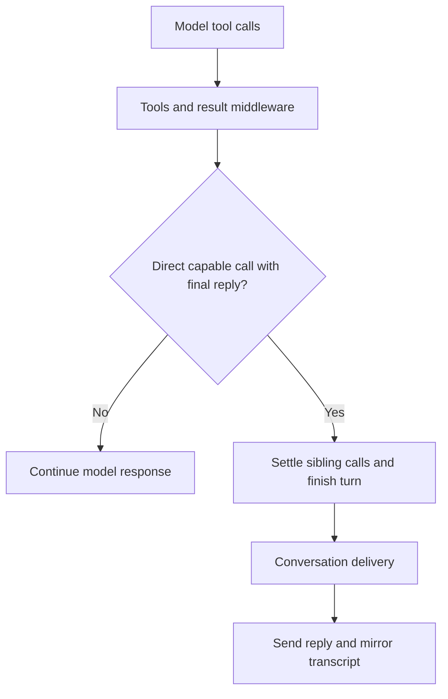

Codex review: needs maintainer review before merge. _Reviewed October 4, 2026, 4:59 AM ET / 08:59 UTC (Revision 11)._

# ClawSweeper review

## What this changes

Adds an optional plugin-tool capability that delivers a finished reply through OpenClaw’s conversation delivery pipeline without another model turn.

## Merge readiness

✅ **Ready for maintainer review**

The work remains useful: current main and the latest release lack this capability. The latest head resolves the prior Codex sibling-completion blocker, and no remaining actionable introduced defect was identified.

**Priority:** P2
**Reviewed head:** `9c8d3d30ec7862a6808f5943dca1fdf4cd1a5795`

## Review scores

| Measure | Result | What it means |
|---|---|---|
| **Overall readiness** | 🐚 platinum hermit **(4/6)** | A useful, focused capability with concrete live evidence and resolved prior completion findings. |
| **Proof confidence** | 🐚 platinum hermit **(4/6)** | Sufficient (live_output): The captured live Telegram comparison exercises embedded reply capture through delivery and shows verbatim output without a post-tool model turn; Codex sibling-order and writer-replacement tests supplement that evidence. No stored-data format or migration contract changes. |
| **Patch quality** | 🐚 platinum hermit **(4/6)** | No actionable review findings were identified. |

## Verification

| Check | Result | Evidence |
|---|---|---|
| **Real behavior** | Verified | Sufficient (live_output): The captured live Telegram comparison exercises embedded reply capture through delivery and shows verbatim output without a post-tool model turn; Codex sibling-order and writer-replacement tests supplement that evidence. No stored-data format or migration contract changes. |
| **Evidence reviewed** | 10 items | Pinned introduction and review continuity: Reviewed the merge-base-to-head introduced changes. GitHub’s exact-head commit patch independently confirms that the latest commit carries the admitted-final-reply fact into lifecycle classification, preserves it across ordinary siblings, and adds both completion-order cases. This resolves the previous completed review’s concrete blocker. Embedded batch completion: The completion hook evaluates finalized results after all batches settle. Regression coverage exercises both sibling orders, rejection before execution, another capable tool without a final reply, structured errors, middleware withdrawal, and blank media; provider-request counts verify the intended continuation decision. Reply admission and dependency signal: The Codex bridge captures the effective result after middleware and extensions, requires the author-declared capability, rejects errors, and admits only the openclaw_direct namespace. Its explicit reliance on Codex excluding that namespace from program calls establishes the dependency-specific inspection requirement. |
| **Findings** | None | None. |
| **Security** | None | None. |

## How this fits together

The agent runtime processes tool results before deciding whether to request another model response. Admitted tool-authored replies pass through the existing conversation delivery owner, which sends them and records the assistant reply after successful delivery.

## Before merge

None.

<strong>Agent review details</strong>

### Security

None.

### PR surface

Source +346, Tests +930, Docs +51, Other +1. Total +1328 across 44 files.

View PR surface stats

| Area | Files | Added | Removed | Net |
|---|---:|---:|---:|---:|
| Source | 25 | 409 | 63 | +346 |
| Tests | 16 | 933 | 3 | +930 |
| Docs | 1 | 51 | 0 | +51 |
| Config | 0 | 0 | 0 | 0 |
| Generated | 0 | 0 | 0 | 0 |
| Other | 2 | 4 | 3 | +1 |
| **Total** | **44** | **1397** | **69** | **+1328** |

### Review metrics

| Metric | Value | Why it matters |
|---|---|---|
| **Production versus regression coverage** | Production +346 net lines; tests and support +930 net lines | Production growth implements the shared opt-in capability in both runtimes, with most added coverage protecting admission and completion regressions. |
| **Plugin contract expansion** | 1 optional tool capability; 1 SDK helper; 0 config options | The new public surface is documented in the PR and tool-plugin guide, while existing tools remain opt-out by default. |

### Technical review

Best possible solution:

Keep one opt-in reply-admission contract across runtimes, with ordinary tools continuing normally and the existing delivery owner retaining send and transcript authority.

Do we have a high-confidence way to reproduce the issue?

Not applicable as a feature request; the captured live comparison demonstrates the extra model-turn cost and the embedded runtime’s improved result.

Is this the best way to solve the issue?

Yes. The patch extends the existing source-reply delivery owner and adds a narrow capability rather than introducing another send or transcript-writing pipeline.

AGENTS.md: found and applied where relevant.

Codex review notes: model internal, reasoning medium; reviewed against [bced15851945](https://github.com/openclaw/openclaw/commit/bced15851945c3c460b48c03896701f9fa304536).

### Labels

Label changes:

- add `rating: 🐚 platinum hermit`: Overall readiness is 🐚 platinum hermit; proof is 🐚 platinum hermit and patch quality is 🐚 platinum hermit.
- add `status: 👀 ready for maintainer look`: ClawSweeper has no concrete contributor-facing blocker left for this PR. Sufficient (live_output): The captured live Telegram comparison exercises embedded reply capture through delivery and shows verbatim output without a post-tool model turn; Codex sibling-order and writer-replacement tests supplement that evidence. No stored-data format or migration contract changes.
- remove `rating: 🦐 gold shrimp`: Current PR rating is `rating: 🐚 platinum hermit`, so this older rating label is no longer current.
- remove `merge-risk: 🚨 message-delivery`: Current PR review selected no merge-risk labels.
- remove `status: ⏳ waiting on author`: Current PR status label is `status: 👀 ready for maintainer look`.

Label justifications:

- `P2`: This is a bounded plugin-runtime latency improvement with opt-in behavior and no demonstrated urgent existing-user regression.
- `rating: 🐚 platinum hermit`: Overall readiness is 🐚 platinum hermit; proof is 🐚 platinum hermit and patch quality is 🐚 platinum hermit.
- `status: 👀 ready for maintainer look`: ClawSweeper has no concrete contributor-facing blocker left for this PR. Sufficient (live_output): The captured live Telegram comparison exercises embedded reply capture through delivery and shows verbatim output without a post-tool model turn; Codex sibling-order and writer-replacement tests supplement that evidence. No stored-data format or migration contract changes.
- `proof: sufficient`: Contributor real behavior proof is sufficient. The captured live Telegram comparison exercises embedded reply capture through delivery and shows verbatim output without a post-tool model turn; Codex sibling-order and writer-replacement tests supplement that evidence. No stored-data format or migration contract changes.
- `proof: telegram-e2e`: This PR needs Telegram Test Server proof with the repository E2E skill. The capability changes visible Telegram reply text and timing; the supplied live comparison demonstrates the embedded behavior.

### Evidence

What I checked:

- **Pinned introduction and review continuity:** Reviewed the merge-base-to-head introduced changes. GitHub’s exact-head commit patch independently confirms that the latest commit carries the admitted-final-reply fact into lifecycle classification, preserves it across ordinary siblings, and adds both completion-order cases. This resolves the previous completed review’s concrete blocker. ([`extensions/codex/src/app-server/run-attempt-lifecycle-controller.ts:120`](https://github.com/openclaw/openclaw/blob/9c8d3d30ec7862a6808f5943dca1fdf4cd1a5795/extensions/codex/src/app-server/run-attempt-lifecycle-controller.ts#L120), [9c8d3d30ec78](https://github.com/openclaw/openclaw/commit/9c8d3d30ec7862a6808f5943dca1fdf4cd1a5795))
- **Embedded batch completion:** The completion hook evaluates finalized results after all batches settle. Regression coverage exercises both sibling orders, rejection before execution, another capable tool without a final reply, structured errors, middleware withdrawal, and blank media; provider-request counts verify the intended continuation decision. ([`src/agents/embedded-agent-runner/run/message-tool-terminal.tool-authored.test.ts:151`](https://github.com/openclaw/openclaw/blob/9c8d3d30ec7862a6808f5943dca1fdf4cd1a5795/src/agents/embedded-agent-runner/run/message-tool-terminal.tool-authored.test.ts#L151), [9c8d3d30ec78](https://github.com/openclaw/openclaw/commit/9c8d3d30ec7862a6808f5943dca1fdf4cd1a5795))
- **Reply admission and dependency signal:** The Codex bridge captures the effective result after middleware and extensions, requires the author-declared capability, rejects errors, and admits only the openclaw_direct namespace. Its explicit reliance on Codex excluding that namespace from program calls establishes the dependency-specific inspection requirement. ([`extensions/codex/src/app-server/dynamic-tool-source-reply.ts:79`](https://github.com/openclaw/openclaw/blob/9c8d3d30ec7862a6808f5943dca1fdf4cd1a5795/extensions/codex/src/app-server/dynamic-tool-source-reply.ts#L79), [9c8d3d30ec78](https://github.com/openclaw/openclaw/commit/9c8d3d30ec7862a6808f5943dca1fdf4cd1a5795))
- **Personally inspected Codex namespace contract:** At the inspected dependency revision, configured direct-only namespaces receive DirectModelOnly exposure, and Code Mode’s nested-tool construction excludes that exposure. Repository identity and the exact dependency SHA were independently verified through GitHub. ([`codex-rs/core/src/tools/spec_plan.rs:520`](https://github.com/openai/codex/blob/a956835d020762cb2b570053af06f643a11c0ecc/codex-rs/core/src/tools/spec_plan.rs#L520), [a956835d0207](https://github.com/openai/codex/commit/a956835d020762cb2b570053af06f643a11c0ecc))
- **Existing delivery and transcript authority:** The changed payload builder uses the existing source-reply metadata. The unchanged dispatch owner checks writer delivery authority, binds transcript metadata to the prepared session/lifecycle/writer, and mirrors only after successful delivery. Added real-session-store tests cover deduplication and writer replacement; they are supplemental persistence coverage, not channel-send proof. ([`src/auto-reply/reply/dispatch-from-config.choose-route.ts:305`](https://github.com/openclaw/openclaw/blob/9c8d3d30ec7862a6808f5943dca1fdf4cd1a5795/src/auto-reply/reply/dispatch-from-config.choose-route.ts#L305), [9c8d3d30ec78](https://github.com/openclaw/openclaw/commit/9c8d3d30ec7862a6808f5943dca1fdf4cd1a5795))
- **Captured real behavior evidence:** The supplied complete PR body, captured under sourceRevision 49b779e8d257d0dfa659735f5f27719d5511f888cc154ec17f6f889bd0941d63, records an embedded-runtime Telegram comparison using two otherwise identical plugin tools. The opted-in reply arrived verbatim without another model turn, with about 0.2 seconds after tool completion versus 6.1 seconds for the ordinary tool; transcript recording followed the send. This demonstrates the changed embedded path, while Codex ordering coverage remains supplemental tests. ([9c8d3d30ec78](https://github.com/openclaw/openclaw/commit/9c8d3d30ec7862a6808f5943dca1fdf4cd1a5795))

Likely related people:

- **steipete:** Suggested for follow-up; no historical authorship or introduction is verified. (role: unverified routing candidate; confidence: low)
- **sjf-oa:** Suggested for follow-up; no historical authorship or introduction is verified. (role: unverified routing candidate; confidence: low)

### Rating scale

| Score | Internal tier | Crab rank | Meaning |
|---:|:---:|---|---|
| **6/6** | S | 🦀 challenger crab | Exceptional readiness |
| **5/6** | A | 🦞 diamond lobster | Very strong readiness |
| **4/6** | B | 🐚 platinum hermit | Good normal PR; ordinary maintainer review |
| **3/6** | C | 🦐 gold shrimp | Useful, but confidence is limited |
| **2/6** | D | 🦪 silver shellfish | Proof or implementation needs work |
| **1/6** | F | 🧂 unranked krab | Not merge-ready |
| N/A | NA | 🌊 off-meta tidepool | Rating does not apply |

Overall follows the weaker of proof and patch quality.
Shiny media proof means a screenshot, video, or linked artifact directly shows the changed behavior. Runtime, network, CSP, and security claims still need visible diagnostics.

### Workflow

- ClawSweeper keeps one durable marker-backed review comment per issue or PR.
- Re-runs edit this comment so the latest verdict, findings, and automation markers stay together instead of adding duplicate bot comments.
- A fresh review can be triggered by eligible `@clawsweeper re-review` comments, exact-item GitHub events, scheduled/background review runs, or manual workflow dispatch.
- PR/issue authors and users with repository write access can comment `@clawsweeper re-review` or `@clawsweeper re-run` on an open PR or issue to request a fresh review only.
- Maintainers can also comment `@clawsweeper review` to request a fresh review only.
- Fresh-review commands do not start repair, autofix, rebase, CI repair, or automerge.
- Maintainer-only repair and merge flows require explicit commands such as `@clawsweeper autofix`, `@clawsweeper automerge`, `@clawsweeper fix ci`, or `@clawsweeper address review`.
- Maintainers can comment `@clawsweeper explain` to ask for more context, or `@clawsweeper stop` to stop active automation.

### History

Review history (10 earlier review cycles; latest 8 shown)

<!-- clawsweeper-review-history v=1 total=10 -->
- reviewed 2026-10-04T03:51:26.704Z sha f8f7853f10e8b6844995b60aba11d483d9c00131 :: needs real behavior proof before merge. :: [P1] [P1] Honor middleware replacements before delivering Codex replies | [P2] [P2] Preserve attachment-only source replies | [P2] [P2] Dispatch progress replies before continuing the model | [P2] [P2] Exclude nested calls from conversation reply admission | [P2] [P2] Join the Codex assistant transcript write before release
- reviewed 2026-10-04T04:52:08.054Z sha b47ed19db9d2bb2c3675debefd387e33f2f664da :: needs real behavior proof before merge. :: [P1] [P1] Honor middleware replacements before delivering Codex replies | [P2] [P2] Preserve attachment-only source replies | [P2] [P2] Dispatch progress replies before continuing the model | [P2] [P2] Exclude nested calls from conversation reply admission | [P2] [P2] Join the Codex assistant transcript write before release | [P3] [P3] Remove the release-owned changelog entry
- reviewed 2026-10-04T06:42:45.676Z sha e73e7347d97ba9712ddd3a5c2552514ce79cbf63 :: needs real behavior proof before merge. :: [P2] [P2] Complete mixed batches after capturing a finished reply | [P2] [P2] Reject native Codex program calls before reply capture
- reviewed 2026-10-04T06:59:10.583Z sha e72ddfcc58c0545e51f28d04b24972492475fcc9 :: needs real behavior proof before merge. :: [P2] [P2] Complete mixed batches after capturing a finished reply | [P2] [P2] Reject native Codex program calls before reply capture
- reviewed 2026-10-04T07:30:40.199Z sha 77d2e99f79a341f369c0176fed66ba019c6ed3a1 :: blocked before merge. :: [P2] Finish mixed batches when another capable call has no final reply | [P3] Control completion order without real timers
- reviewed 2026-10-04T07:41:23.156Z sha e1591fafa2ee4a96004f75f31802f9136b9e340c :: blocked before merge. :: [P2] Finish the batch after any admitted final tool reply | [P3] Control tool completion order without real timers
- reviewed 2026-10-04T08:12:02.598Z sha d013fb1f87865a76b809405b72aff264652c4d33 :: blocked before merge. :: [P2] Reject blank media before admitting a finished reply
- reviewed 2026-10-04T08:31:28.730Z sha 0b3c8b8dc54083ec3dd2c31359e54e204dbfb2a7 :: blocked before merge. :: [P2] Preserve Codex completion across ordinary sibling results

<!-- clawsweeper-verdict:needs-human item=164558 sha=9c8d3d30ec7862a6808f5943dca1fdf4cd1a5795 confidence=high updated_at=2026-10-04T08:55:32Z reviewed_at=2026-10-04T08:59:31.080Z lease_owner=github-run-37190441742-1 lease_comment_id=5978293940 source_revision=49b779e8d257d0dfa659735f5f27719d5511f888cc154ec17f6f889bd0941d63 live_verification=absent -->
<!-- clawsweeper-review-state:ready item=164558 sha=9c8d3d30ec7862a6808f5943dca1fdf4cd1a5795 v=1 -->

<!-- clawsweeper-review-version item=164558 reviewed_at=2026-10-04T08:59:31.080Z sha=9c8d3d30ec7862a6808f5943dca1fdf4cd1a5795 source_revision=49b779e8d257d0dfa659735f5f27719d5511f888cc154ec17f6f889bd0941d63 lease_owner=github-run-37190441742-1 lease_comment_id=5978293940 v=1 -->

<!-- clawsweeper-review item=164558 -->